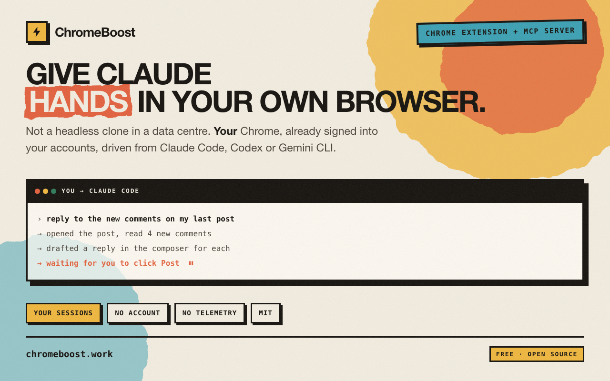
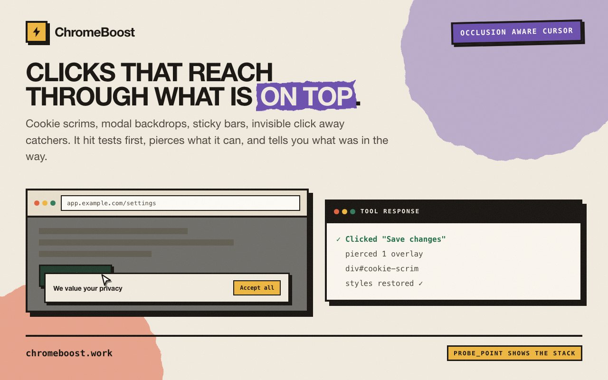
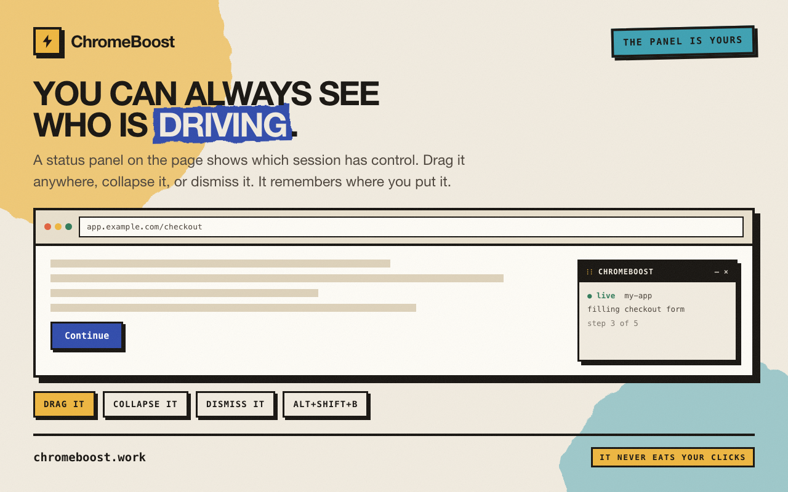

<div align="center">

# ⚡ ChromeBoost

**Give Claude hands in your own browser.**

Not a headless clone in a data centre — *your* Chrome, already signed into your accounts,
driven by real clicks, drags and keystrokes that modern web apps actually accept.

[**chromeboost.work**](https://chromeboost.work) · [Chrome Web Store](https://chromewebstore.google.com/detail/chromeboost/alphgffnpbhpfaimmaaibbcdmpmcbndo) · [Install](#install) · [What to ask it](#things-people-actually-say-to-it) · [Tools](#tool-surface) · [☕ Buy me a coffee](https://buy.stripe.com/6oU6oHbqTcD8gSQ1rQbAs00)

MIT · no account · no telemetry

<br>



</div>

---

ChromeBoost is a Chrome extension plus an MCP server. Together they let Claude Code drive the
browser sitting in front of you — the one with your sessions, your cookies, your logged-in
dashboards. You ask in plain English and watch it happen.

**Anything irreversible stops and waits for you.** Posts, payments, passwords and 2FA are yours
to confirm; ChromeBoost fills in everything around them and hands back control.

## Things people actually say to it

> *"Reply to the new comments on my last post — draft each one and I'll hit Post."*

Opens the post, reads the thread, types a reply into the composer for each comment. It stops at
Post every time: the button gets highlighted and it waits for your click, so nothing goes out in
your name that you didn't read.

> *"Grab my Stripe test keys and put them in .env"*

Navigates to the dashboard you're already logged into, opens Developers → API keys, reveals the
secret, writes it straight to `.env`. The key never touches your clipboard.

> *"Walk through our signup flow and screenshot every step into ./docs"*

Drives the flow like a new user — fills the form, submits, waits for each screen — saving a
numbered screenshot at every step. Onboarding docs that rebuild themselves.

> *"Drag the seat slider to 50 and tell me what it costs"*

A slider has no button to click. ChromeBoost presses, moves through real intermediate positions,
releases, then reads the price back off the page.

> *"Download last month's invoices from the billing portal"*

Signs in as you, filters the date range, pulls every PDF using your real session cookies — the
files a logged-out scraper can't reach.

## Why it works where scripts don't

**It doesn't teleport.** A normal automation script jumps a cursor to coordinates and fires a
click event. ChromeBoost sends the whole gesture through Chrome's own input pipeline — a curved
approach, a settle tremor before it lands, pressure on the way down, keystrokes that arrive as
real key events. React, TipTap, ProseMirror, CodeMirror, Monaco and Stripe's contenteditable
fields all register input that scripted events silently swallow.



**Cookie banners don't stop it.** This is what breaks most browser agents: a page paints a scrim,
a modal backdrop, or an invisible catch-all `<div>` over the button, the click lands on *that*,
and the agent gets told it worked. It then argues with a button it never pressed. ChromeBoost
hit-tests the target first — aims at a part of it that's actually exposed, scrolls out from under
fixed bars, steps the overlay aside for the duration of a single click and puts it straight back.
When something genuinely can't be reached, it names the element in the way instead of claiming
success.

**Not everything is click-shaped.** `hover` for menus and row actions that only exist while the
pointer is on them. `drag` for sliders, canvas and WebGL apps, map panning, sortable lists,
resize handles.

## Install

You need **Chrome** and **Claude Code**. Nothing to clone, no build step: the extension is on the
Chrome Web Store and the plugin carries the MCP server.

### 1. Add the plugin

In Claude Code, run these **one at a time** — not as a single paste:

```
/plugin marketplace add lordamdal/chromeboost
```

```
/plugin install chromeboost@chromeboost
```

Then restart Claude Code so the MCP server starts.

### 2. Add the extension

[**Install ChromeBoost from the Chrome Web Store**](https://chromewebstore.google.com/detail/chromeboost/alphgffnpbhpfaimmaaibbcdmpmcbndo)

Click **Add to Chrome**, then pin ChromeBoost to the toolbar so the popup is one click away.
That's the whole install: no developer mode, no folder to keep around, and it updates itself.

Running `/chromeboost-setup` in Claude Code does the same walkthrough and then verifies the
connection for you, which is worth it if anything looks off.

> **Already running the unpacked copy?** Remove it at `chrome://extensions` when you add the store
> build. Both connect to the same local port and the server keeps only one connection, so the two
> evict each other in a loop. Two ChromeBoost cards on that page is the tell.

### 3. Point it at a window

Click the ChromeBoost icon in the toolbar. Your session appears with a green dot — hit **Use this
window** to bind the Chrome window you want driven. Then try:

```
open news.ycombinator.com and give me the top 5 stories
```

### Using Gemini CLI instead?

ChromeBoost ships as a Gemini CLI extension too. The Chrome half is identical;
only the packaging differs.

```
gemini extensions install https://github.com/lordamdal/chromeboost
```

Restart Gemini, then run `/chromeboost-setup` exactly as above.

Gemini extension manifests cannot set `trust`, so if you want ChromeBoost's
tools to run without a confirmation each time, add it to `~/.gemini/settings.json`:

```json
{
  "mcpServers": {
    "chromeboost": { "trust": true }
  }
}
```

> **Worth understanding before you set that.** `trust: true` runs every
> ChromeBoost tool unprompted, including `execute_script`, which is arbitrary
> JavaScript in whatever authenticated tab is active. `trust: false` (the
> default) prompts instead, but in headless runs (`gemini -p`, piped stdin) a
> prompt is treated as a **denial**, so long autonomous tasks fail partway.
>
> For autonomy without the blanket switch, skip `trust` and use Gemini's policy
> engine instead. See [`docs/gemini.md`](docs/gemini.md).

### Using Codex instead?

Codex registers a command to run rather than fetching a package, so it needs a local
clone. This one paste does the whole thing, with no config file to hand-edit:

```bash
git clone https://github.com/lordamdal/chromeboost ~/.chromeboost/src \
  && npm --prefix ~/.chromeboost/src install \
  && npm --prefix ~/.chromeboost/src run build \
  && codex mcp add chromeboost --env CHROMEBOOST_HOST=codex \
       -- node ~/.chromeboost/src/packages/plugin/server/chromeboost.mjs
```

Restart Codex, then run `/chromeboost-setup` as above.

To update later:

```bash
git -C ~/.chromeboost/src pull && npm --prefix ~/.chromeboost/src run build
```

### If something goes wrong

<details>
<summary><b>The first command opens a dialog asking for a "marketplace source"</b></summary>

It wants the repo on its own, without the `/plugin` prefix:

```
lordamdal/chromeboost
```

</details>

<details>
<summary><b>Permission denied or host-key error when adding the marketplace</b></summary>

`owner/repo` shorthand clones over SSH. Use the HTTPS URL instead:

```
https://github.com/lordamdal/chromeboost.git
```

Or set `CLAUDE_CODE_PLUGIN_PREFER_HTTPS=1` to make shorthand clone over HTTPS.

</details>

<details>
<summary><b>No green dot in the popup</b></summary>

The extension is loaded but hasn't connected. Hit the reload arrow on the ChromeBoost card in
`chrome://extensions` — it reconnects on a backoff timer, and a reload forces it immediately.

</details>

<details>
<summary><b>After updating the plugin</b></summary>

Nothing to do for the extension: the Chrome Web Store build updates itself. `/plugin update
chromeboost` only refreshes the MCP server, so restart Claude Code afterwards.

If you're running the unpacked copy instead, run `/chromeboost-setup` and ask for the unpacked
path. It overwrites `~/Downloads/ChromeBoost-Extension` in place, so you only need to hit reload
in `chrome://extensions`, with no re-picking the folder.

</details>

<details>
<summary><b>Tool calls fail at random, or the green dot keeps dropping</b></summary>

Check `chrome://extensions` for **two** ChromeBoost cards, usually the store build alongside an
older unpacked copy. They both connect to the same local port, the server keeps only one
connection, and each new one evicts the other, so they trade the socket back and forth on their
reconnect timers. Remove whichever one you don't want.

</details>

<details>
<summary><b>Build from source instead</b></summary>

```bash
git clone https://github.com/lordamdal/chromeboost
cd chromeboost
npm install
npm run build
```

Load `packages/extension/dist` unpacked, then
`/plugin marketplace add /absolute/path/to/chromeboost`.

To register the MCP server by hand instead of using the plugin:

```json
{
  "mcpServers": {
    "chromeboost": {
      "command": "node",
      "args": ["/absolute/path/to/chromeboost/packages/plugin/server/chromeboost.mjs"]
    }
  }
}
```

You lose the bundled skill and permission allowlist, so you'll be prompted on every tool call.

</details>

## The HUD

While Claude drives, a small panel sits on the page so you know a session is in control and which
one.



| Action | How |
|---|---|
| Move it | Drag the header — it snaps flush to an edge if you drop it near one |
| Collapse it | Double-click the header, or the `–` button |
| Hide it | The `×` button |
| Bring it back | `Alt`+`Shift`+`B` on any page, or **Show** in the toolbar popup |

Position and state persist, so you only ever move it once. It lives in a closed shadow root — no
page can restyle it or find it — and only the panel itself takes clicks, never the space around
it. It's kept out of screenshots automatically.

## Where it stops

An agent with your logins shouldn't be able to publish in your name, move your money, or pass
your 2FA on its own — and this one can't.

- **Publishing** — posts, comments and replies are drafted into the composer; the Post button is
  highlighted and waits for your real click.
- **Passwords & 2FA** — never typed. It brings you to the field and pauses. Secrets visible on
  screen are redacted out of what Claude reads by default.
- **Payments & captchas** — yours to confirm. Captchas aren't solved or faked; ChromeBoost
  reports one is present and steps back.

## Tool surface

35 tools. You won't type any of them — Claude picks them — but here's what it can do:

| Tool | For |
|---|---|
| `hover` | Hover-only menus, row actions at `opacity: 0`, tooltips, chart crosshairs |
| `drag` | Sliders, canvas/WebGL, map panning, sortable lists, resize handles |
| `probe_point` | Report what's actually painted at a spot — diagnoses a click that went nowhere |
| `hud` | Move, dock, collapse or hide the on-page panel |
| `click_element` · `click_at_coordinates` | Trusted clicks that hit-test first and get past overlays |
| `fill_input` · `fill_form` · `type_text` | Real keystrokes through React, contenteditable, CodeMirror, Monaco, TipTap |
| `get_page_text` · `find_text` · `get_form_fields` | Read the page, including closed shadow DOM; secrets redacted |
| `open_page` · `wait_for` · `list_tabs` · `switch_to_tab` | Navigate, wait, work across tabs |
| `take_screenshot` · `download_file` · `read_attachment` | Capture steps, pull authenticated files, read PDFs |
| `fetch_url` · `inspect_request_headers` | Requests with your real cookies, bypassing page CSP |
| `highlight_region` · `wait_for_click` | Hand control back to you |
| `write_to_env` | Put a captured key straight into `.env` |

Full agent-facing guide: [`packages/plugin/skills/chromeboost/SKILL.md`](packages/plugin/skills/chromeboost/SKILL.md).

## Development

```bash
npm install
npm run build      # both halves; also syncs the extension into the plugin
npm run dev:ext    # extension, watch mode
npm run dev:mcp    # MCP server, tsc watch
```

Reload the extension at `chrome://extensions` after changing extension source. Restart Claude
Code after changing MCP server source.

| Path | What |
|---|---|
| `packages/extension/src/content/hittest.ts` | Occlusion-aware hit testing + overlay piercing |
| `packages/extension/src/content/hud.ts` | The draggable HUD (closed shadow root) |
| `packages/extension/src/background.ts` | CDP dispatch: click, hover, drag; pierce/restore |
| `packages/mcp-server/src/tools/cursor.ts` | `hover`, `drag`, `probe_point`, `hud` |
| `packages/plugin/` | Plugin manifest, skill, and the bundled extension payload |
| `apps/website/index.html` | Landing page — static, no build step |
| `tests/overlays/` | Occlusion regression fixture |

`CLAUDE.md` is the repo-developer guide.

## Support

ChromeBoost is free, MIT-licensed, and has no telemetry — the server only ever talks to your own
browser. If it saved you an afternoon:

**[☕ Buy me a coffee](https://buy.stripe.com/6oU6oHbqTcD8gSQ1rQbAs00)**

## License

MIT — see [LICENSE](LICENSE).
